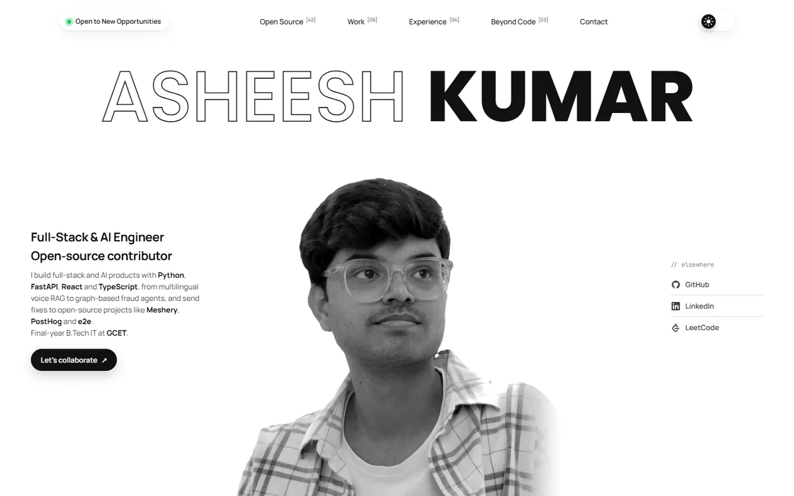
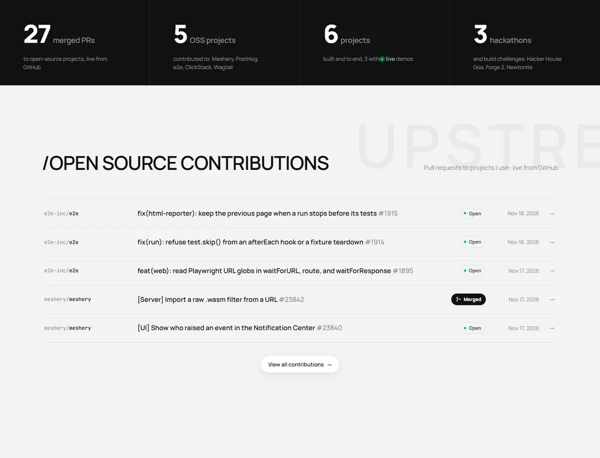
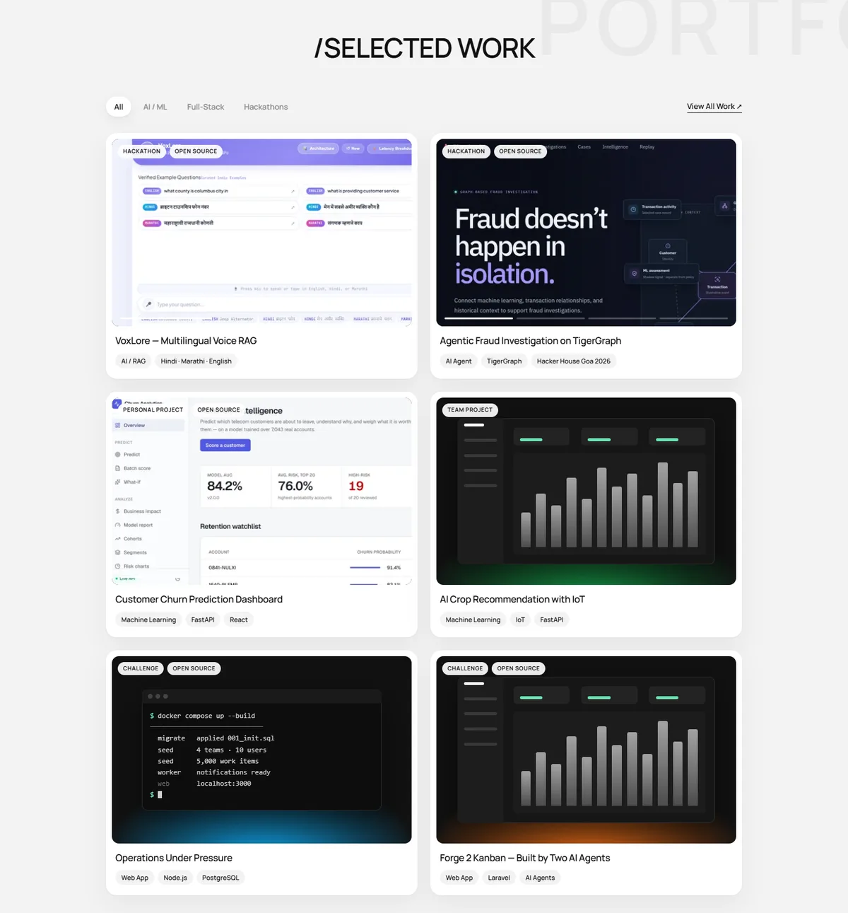
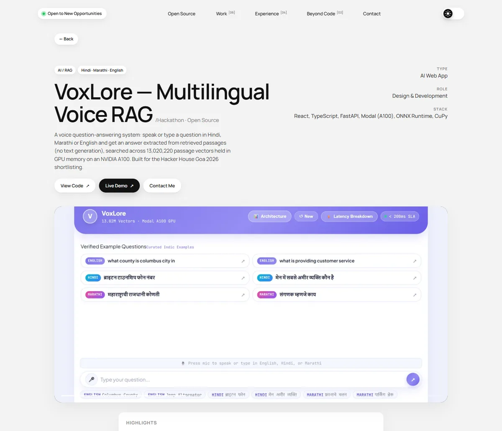

# Asheesh Kumar · Portfolio

Personal portfolio of **Asheesh Kumar** ([@Asheesh7298](https://github.com/Asheesh7298)): full-stack and AI engineer, open-source contributor to Meshery, PostHog and e2e, and final-year B.Tech IT student at GCET (2023–2027).

**Live:** [asheesh7298.vercel.app](https://asheesh7298.vercel.app/)

A static site: plain HTML, CSS and JavaScript with no framework and no build step for the page itself. It has light and dark themes, project pages, live open-source data from GitHub, scroll animations and an inspector-style cursor.

| Light | Dark |
| --- | --- |
|  |  |


## Sections

- **Hero.** Name, title, a short intro, a contact button and links to GitHub, LinkedIn and LeetCode.
- **At a glance.** Merged PRs, open-source projects, projects built and hackathons. The first two numbers update from GitHub when the open-source list loads.
- **Open source.** My pull requests to other people's repositories, loaded live from the GitHub API, latest first. `#/open-source` lists all of them, and each PR has its own page (`#/open-source/<owner>/<repo>/<number>`) with its status, who merged it, the description and the files changed. Responses are cached in `sessionStorage` for 15 minutes.
- **Selected work.** Four projects, filterable by AI / ML, Full-Stack and Hackathons. Each card opens a project page (`#/work/<slug>`) with screenshots, the stack, highlights and links.
- **Experience.** Open-source work (Meshery, PostHog, e2e) and education. Rows expand; on desktop, hovering a row shows a metric.
- **Beyond code.** Certifications, hackathons and an open-source summary.
- **Contact.**







## Project structure

```
index.html            Page markup: hero, stats, section shells, Beyond code, contact, footer, SEO metadata
styles.css            All styles: tokens, light/dark themes, sections, responsive rules
main.js               Content (PROJECTS, EXPERIENCE) and rendering; open-source loader; interactions
analytics.js          Optional Firebase + PostHog loader and event tracking
scripts/
  build-config.mjs    Writes firebase-config.js and posthog-config.js from environment variables
assets/               Portrait, project screenshots (WebP), icons, Open Graph image
docs/screenshots/     Screenshots used in this README
vercel.json           Build command and cache headers
```

## Editing content

| What | Where |
| --- | --- |
| Projects and project pages | `PROJECTS` in `main.js` |
| Experience rows | `EXPERIENCE` in `main.js` |
| Open source | Nothing to edit: new PRs appear on their own. Hide a repo with `OSS_HIDE` in `main.js` |
| Hero, stats, Beyond code, contact, SEO | `index.html` |

Project screenshots follow the same sizes as the rest of `assets/`: desktop `*-xl-NN.webp` at 2256×1128 (a 1128×564 viewport at 2×) with `-1200` and `-640` copies, and phone `*-sm-NN.webp` at 686×514. Add a new desktop image to `IMG_W` in `main.js` so the browser can pick the right size.

## Run locally

Any static file server works

```sh
python -m http.server 8080
# then open http://localhost:8080
```

Analytics stay off unless their config files exist, so the two 404s for `firebase-config.js` and `posthog-config.js` are expected locally. To turn analytics on, add the keys to a `.env` file and run `node scripts/build-config.mjs`.

| Variable | Used for |
| --- | --- |
| `FIREBASE_API_KEY`, `FIREBASE_AUTH_DOMAIN`, `FIREBASE_PROJECT_ID`, `FIREBASE_STORAGE_BUCKET`, `FIREBASE_MESSAGING_SENDER_ID`, `FIREBASE_APP_ID`, `FIREBASE_MEASUREMENT_ID` | Firebase Analytics (the `FIREBASE_` prefix is optional) |
| `POSTHOG_KEY`, `POSTHOG_HOST` (optional, defaults to US cloud) | PostHog |

## Deployment

Made for [Vercel](https://vercel.com): `vercel.json` runs `node scripts/build-config.mjs` as the build command, serves the repo root as the site, and sets cache headers for assets, CSS and JS. The Vercel project is connected to this repo, so every merge to `main` deploys to production at https://asheesh7298.vercel.app/. If the address changes, update the canonical link and the `og:` / `twitter:` image URLs in `index.html`, plus `sitemap.xml` and `robots.txt`.

## Contacts

- Email: [asheeshkumarklg712@gmail.com](mailto:asheeshkumarklg712@gmail.com)
- [LinkedIn](https://www.linkedin.com/in/asheesh712/) · [GitHub](https://github.com/Asheesh7298) · [LeetCode](https://leetcode.com/u/KO5Pwip6Ln/)
